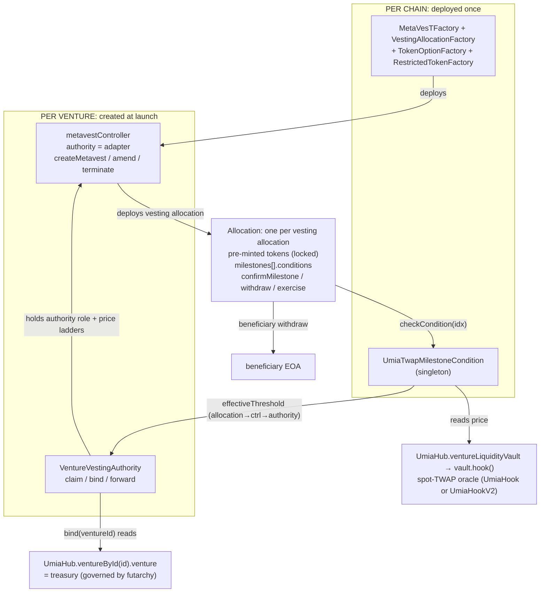
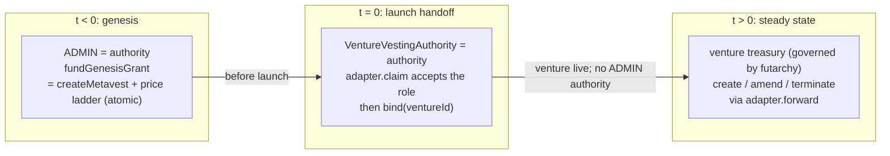
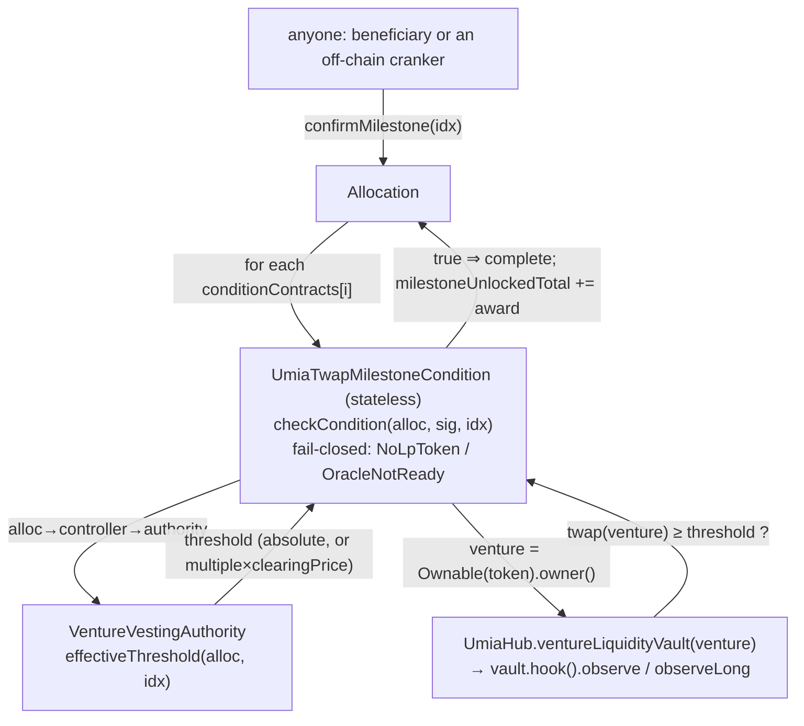
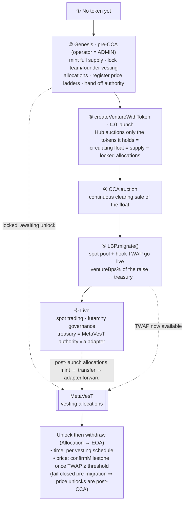
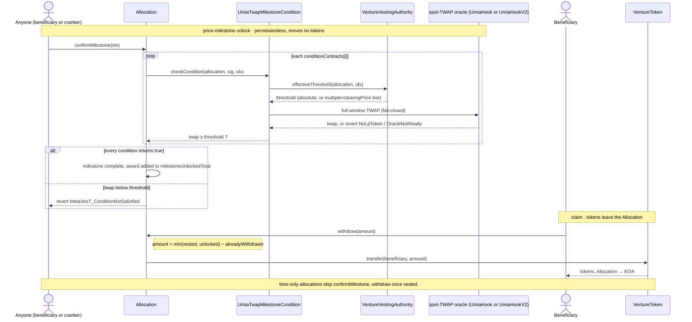

# MetaVesT Vesting Integration

How Umia uses MetaLeX [MetaVesT](https://github.com/MetaLex-Tech/MetaVesT) as the
canonical vesting / allocation layer for ventures.

Related docs: [`UmiaTwapMilestoneCondition`](../contracts/UmiaTwapMilestoneCondition.md) and
[`VentureVestingAuthority`](../contracts/VentureVestingAuthority.md) (contract references), and
[Deployment](#deployment) below for the per-chain singletons.

## Overview

A project can launch with pre-existing team and founder vesting allocations and run
two kinds of unlock schedule:

- **time-based**: linear vesting with cliffs, and
- **price-based**: release gated on the venture spot-pool TWAP crossing a threshold,

both funded from the venture treasury and governed after launch by futarchy.

The carve-out is **pure orchestration**. It adds exactly two Umia contracts,
`UmiaTwapMilestoneCondition` and `VentureVestingAuthority`, and touches the Hub only
through its `ventureById` getter, the owner-set `vestingAdmin` slot (`setVestingAdmin`), and
the per-venture authority registry (`ventureVestingAuthority`, set by
`setVentureVestingAuthority`; its `VentureVestingAuthoritySet` event is the only onchain link
from a venture to its adapter). Everything else is MetaVesT (imported as a git submodule) wired
together by the launch sequence and, after launch, by futarchy through the authority adapter.

### Architecture at a glance



The condition is the only contract that touches the spot oracle.

## Key decisions

1. **MetaVesT is the single vesting engine.** Time unlocks use MetaVesT's native
   schedules; price unlocks use `UmiaTwapMilestoneCondition`, a MetaVesT
   `IConditionM` that reads the spot hook TWAP (`UmiaHook` or `UmiaHookV2`, whichever the
   Hub's current vault for the venture points at), fail-closed.
2. **Pre-mint + lock only.** MetaVesT cannot mint, so the full allocation is
   minted up front and locked in the allocation contract. Circulating-vs-total is a
   read anyone can derive from the locked allocations.
3. **Authority = venture treasury (futarchy) in steady state.** Genesis vesting
   allocations are created pre-t=0 by the launch operator, then the controller
   authority is handed to a per-venture `VentureVestingAuthority` adapter **before**
   `createVentureWithToken`. There is no post-launch bootstrap window and no seeded
   governance market.
4. **Pure orchestration.** Only the two new contracts; the adapter reads
   `UmiaHub.ventureById(id)` and `UmiaHub.vestingAdmin()`.

## MetaVesT primitives

MetaVesT is pulled in as a git submodule at `lib/metavest` (AGPL-3.0), consumed via the
`@metavest/` remapping. The pieces the integration uses:

- **`MetaVesTFactory.deployMetavestAndController(authority, dao, vestingFactory,
  tokenOptionFactory, restrictedTokenFactory)`** → deploys one `metavestController`
  bound to a single `authority` (and optional `dao` for function-level conditions).
- **Three allocation types**, each deployed by the controller via its factory and
  holding pre-minted tokens:
  - `VestingAllocation`: linear vest + cliffs (`getVestingType() == 1`).
  - `TokenOptionAllocation`: exercise-priced (`== 2`).
  - `RestrictedTokenAward`: lapse / repurchase (`== 3`).
- **Allocation data** (read by the condition):

  ```
  Allocation { uint256 tokenStreamTotal; uint128 vestingCliffCredit;
               uint128 unlockingCliffCredit; uint160 vestingRate;
               uint48 vestingStartTime; uint160 unlockRate;
               uint48 unlockStartTime; address tokenContract }
  Milestone  { uint256 milestoneAward; bool unlockOnCompletion; bool complete;
               address[] conditionContracts }
  getMetavestDetails() → Allocation        grantee() → address
  milestoneAwardTotal() milestoneUnlockedTotal()
  ```

- **Milestones.** Up to 20 per allocation. `confirmMilestone(idx)` is permissionless
  and completes a milestone only if **every** `conditionContracts[i]` returns true:

  ```
  IConditionM(c).checkCondition(address(this), msg.sig, abi.encodePacked(idx)) == true
  ```

  On completion, `milestoneAward` is added to `milestoneAwardTotal` and, if
  `unlockOnCompletion`, to `milestoneUnlockedTotal`.
- **Authority** creates/amends/terminates vesting allocations through the controller
  (gated by `onlyAuthority`); the optional **`dao`** can register function-level
  conditions.

The price condition plugs into a milestone's `conditionContracts` array.

## Dependency + shared singletons

MetaVesT is a git submodule at `lib/metavest` (from `MetaLex-Tech/MetaVesT`, AGPL-3.0),
consumed the same way as the other `lib/` submodules (OpenZeppelin, Solady,
v4-core). The remapping `@metavest/=lib/metavest/src/` is declared in `foundry.toml`
and `remappings.txt`; the pinned version is the submodule reference tracked in this
repository, and `lib/` is excluded from compiler warnings
(`ignored_warnings_from = ["lib/"]`). Deployed Umia contracts never import it: the condition
and the adapter reach MetaVesT through minimal local interfaces, so the AGPL dependency stays
in tests and scripts (`check-licenses.sh` enforces this).

**Deployment topology:**

| Scope | Contracts | Created by |
| --- | --- | --- |
| Per chain (once) | `MetaVesTFactory`, the 3 allocation factories, `UmiaTwapMilestoneCondition` | a deploy script, see [Deployment](#deployment) |
| Per venture | `metavestController`, `VentureVestingAuthority` | the [genesis sequence](#genesis-sequence) |
| Per vesting allocation | an `Allocation` (Vesting / TokenOption / RestrictedToken) | `controller.createMetavest` |

Nothing onchain stores the per-chain singleton addresses; whoever runs a launch supplies them.

## Authority model

The MetaVesT controller has a single `authority` that creates and amends vesting
allocations. The integration drives it in two phases.



- **Genesis (pre-t=0).** The launch operator (ADMIN) is the controller authority. It
  funds and creates the genesis vesting allocations and their price ladders in one call
  each (`fundGenesisGrant`, which forwards `createMetavest` and registers the ladder
  atomically). It then hands the authority role to the per-venture
  `VentureVestingAuthority` adapter **before** `createVentureWithToken` runs, closing
  any window in which ADMIN could mint or amend once the venture is live.
- **Steady state.** The controller authority is the adapter; the venture treasury
  (futarchy) drives it through `forward`. A passed proposal runs through the
  `GovernanceExecutor` (callable only by `UmiaMarketCore`), which drives the
  treasury's `onlyExecutor` entrypoints, and `Venture.executeCall(adapter, 0, forward(…))`
  relays it; the adapter sees `msg.sender == treasury` and forwards to the controller
  as the authority. Post-launch vesting allocations and amendments are governance
  proposals; terminations go through `terminateGrant` / `terminateAndReissue`, callable by
  the treasury or the Hub's `vestingAdmin`.

## `VentureVestingAuthority` adapter

A per-venture adapter that holds the controller `authority` role and routes it to the
treasury, **and is the per-allocation price-milestone registry**: a grant's price
ladder is written here in the same transaction as `createMetavest`, so grants and
ladders share one mutating path and one auth gate. Sketch:

```solidity
contract VentureVestingAuthority {
    enum PriceProgramKind { None, Absolute, Relative }
    struct PriceProgramInput {
        PriceProgramKind kind;
        uint160[] absoluteThresholds;  // kind == Absolute (Q96, moneyToken per ventureToken)
        uint256[] multiplesX1e6;       // kind == Relative (1e6 scale: 2x == 2_000_000)
        uint48[] cliffs;               // optional per-milestone cliff timestamps; 0 = price-only
    }

    address public immutable deployer;     // the launch operator; set in the constructor
    address public immutable hub;
    address public immutable controller;
    address public treasury;               // set once, in bind()
    address public ventureToken;           // set once, in bind()
    bool    public bound;
    bool    public genesisClosed;
    bool    public vestingAdminRevoked;    // venture opt-out of the Hub vestingAdmin path

    constructor(address hub_, address controller_);

    /// Accept the controller's pending-authority role (its two-step handoff). Permissionless:
    /// succeeds only if the controller already set this adapter as pending.
    function claim() external;              // controller.acceptAuthorityRole()

    /// Resolve the treasury from the Hub and lock it in, and grant the controller a standing
    /// allowance of the venture token so futarchy-funded grants can be pulled. Deployer-gated,
    /// write-once; the treasury comes from the Hub, never from caller input.
    function bind(uint256 ventureId) external {
        // require(msg.sender == deployer && !bound);
        // treasury = UmiaHub.ventureById(ventureId).venture;
        // IERC20(IVenture(treasury).token()).approve(controller, type(uint256).max);
    }

    /// Forward an authority call (createMetavest / amend / terminate) to the controller, and
    /// register the price ladder when the call is createMetavest. Gated to the bound treasury,
    /// so only futarchy can drive it. priceProgram.kind must be None for non-createMetavest calls.
    function forward(bytes calldata data, PriceProgramInput calldata priceProgram)
        external returns (bytes memory);    // controller's onlyAuthority sees address(this)

    /// Terminate a grant (treasury or Hub vestingAdmin). The clawback is swept to the treasury, or
    /// recycled into a replacement grant by terminateAndReissue. Both revert while liquidating.
    function terminateGrant(address allocation) external;
    function terminateAndReissue(address allocation, bytes calldata createMetavestCalldata,
        PriceProgramInput calldata priceProgram) external returns (address newAllocation);
    function sweep(address token) external;                   // permissionless, to the treasury
    function setVestingAdminRevoked(bool revoked) external;   // treasury-only

    /// The threshold the condition compares the TWAP against, resolved live:
    ///   Absolute → the stored Q96 threshold
    ///   Relative → multiple * cca().clearingPrice() / 1e6 (capped at uint160)
    /// Reverts NotRegistered (no program / idx out of range), NotBound (relative program read
    /// before bind) or AuctionNotCleared (bound, but no auction or a 0 clearing price).
    function effectiveThreshold(address allocation, uint256 idx) external view returns (uint160);

    /// The milestone's cliff timestamp (0 = price-only).
    function effectiveCliff(address allocation, uint256 idx) external view returns (uint48);

    /// The venture's auction, resolved live as IUmiaLBP(venture.lbp()).initializer().
    /// Zero before bind. No stored CCA; relative thresholds are lazy.
    function cca() external view returns (address);
}
```

- `bind` is deployer-gated and write-once, and resolves the treasury from
  `UmiaHub.ventureById(id).venture`, not from caller input, so ADMIN cannot redirect
  the adapter after handoff, and a stranger cannot front-run the bind to a different
  venture.
- **Funding.** `createMetavest` pulls a grant's tokens from the controller's
  `authority`, which is this adapter. So a post-launch grant is funded by transferring
  its tokens to the adapter; the standing allowance `bind` grants lets the controller
  pull them. The adapter never custodies tokens beyond the in-flight grant.
- **Atomic price ladder.** A grant's ladder (`PriceProgramInput`) is supplied to the
  same call that creates the grant (`fundGenesisGrant` at genesis, `forward`
  post-launch) and stored **write-once** per allocation. `kind == None` means no price
  milestones; a non-`None` ladder must be strictly ascending and non-zero, and may only
  ride a `createMetavest` call. The condition reads thresholds back via
  `effectiveThreshold`; there is no separate registration on the condition and no
  finalize step.
- **No stored CCA; lazy relative thresholds.** The adapter stores no auction reference.
  `cca()` resolves the venture's auction live (`venture.lbp().initializer()`), so a
  relative ladder's threshold is `multiple × clearingPrice` computed at read time and
  always reflects the current clearing price. For a relative ladder `effectiveThreshold`
  reverts `NotBound` before `bind`, and `AuctionNotCleared` once bound while no auction
  resolves or its clearing price is still 0.
- `forward` is the governance mutating path post-launch and is gated to the treasury. A
  passed proposal reaches it through `Venture.executeCall`, whose outbound `msg.sender`
  is the Venture (= the bound treasury), so the gate holds. It rejects
  `initiateAuthorityUpdate` (`AuthorityTransferForbidden`) and `terminateMetavestVesting`
  (`UseTerminateGrant`).
- **Grant administration.** `terminateGrant` / `terminateAndReissue` terminate a grant and
  sweep or recycle its clawback. The treasury may call them, and so may the Hub's
  `vestingAdmin` unless the venture opted out (`setVestingAdminRevoked`); both revert during
  liquidation. `sweep` is permissionless and only ever pays the treasury.
- Reads the existing **`UmiaHub.ventureById(id)`** getter (`VentureInfo.venture` is the
  treasury); no protocol or launch-path change.

## Price unlocks: `UmiaTwapMilestoneCondition`

A shared singleton `IConditionM` that gates a milestone on the venture spot-pool TWAP.
Full detail: [`UmiaTwapMilestoneCondition`](../contracts/UmiaTwapMilestoneCondition.md).



- The condition holds **no state**: it stores nothing per allocation, has no owner or
  auth, and emits no events. The price ladder lives on the venture's adapter, written
  atomically with the grant.
- `checkCondition(allocation, sig, data)` decodes the milestone index from `data`
  (`abi.encode(uint256)`), resolves the threshold from the calling allocation's adapter
  (`allocation → controller → authority → effectiveThreshold(allocation, idx)`), and
  returns whether the current full-window TWAP meets it. The threshold is resolved
  first, so an unregistered, unbound or not-yet-cleared milestone surfaces the adapter's
  `NotRegistered` / `NotBound` / `AuctionNotCleared` revert.
- Thresholds resolve **live**: an absolute ladder returns its stored Q96 value, a
  relative ladder returns `multiple × clearingPrice` against the venture's auction at
  read time. There is no anchoring or finalize step.
- The TWAP read is fail-closed: it reverts `NoLpToken` before the pool exists and
  `OracleNotReady` before the oracle can serve the full window, never degrading to a
  shorter window. The pool and its hook are resolved from the Hub's current vault for the
  venture (`SpotLiquidityVault` or, after a V2 migration, `SpotLiquidityVaultV2`), so the
  read follows the venture onto `UmiaHookV2`; the token's venture from `VentureToken`
  ownership.

> ### ⚠️ Never mutate the milestone set of a price-gated grant after creation
>
> The milestone→threshold binding is **positional**. `confirmMilestone(i)` passes the array
> index `i` into `checkCondition`, which reads rung `i` from the write-once ladder on the
> adapter. The ladder is registered in lockstep at grant creation, so indices line up, but
> nothing keeps them aligned if the milestone array is later reordered. There is **no safe
> in-place mutation**:
>
> - **Removal fails open.** MetaVesT removes a milestone by swap-and-pop, so removing any
>   non-last milestone relocates the last (and, because registration enforces ascending
>   thresholds, highest-threshold) tranche onto a lower rung. That tranche becomes
>   confirmable at a cheaper price with a different or absent cliff: an unearned early unlock
>   of the largest award.
> - **Append fails closed.** Adding a milestone pushes past the ladder length, so
>   `effectiveThreshold`/`effectiveCliff` revert `NotRegistered` and that milestone can never
>   confirm, and its award is locked in the allocation forever.
>
> The ladder is immutable (`ProgramAlreadyRegistered`), so neither can be corrected afterward.
>
> **Rule:** treat a price-gated grant's milestone set as frozen at creation. Do **not** build a
> governance payload that forwards a milestone add or remove for an allocation carrying a
> registered price program. If the set must change, **terminate and re-create** the grant
> (`terminateAndReissue` does both in one call); re-creation rebuilds the ladder in lockstep and
> is always correct.

## Lifecycle & orchestration

The whole cycle, from before a token exists to a live futarchy-governed venture, with
the MetaVesT touchpoints marked. Genesis vesting is set up **pre-CCA** (allocations are
carved out before the auction); **price** unlocks can only fire **post-CCA**, once
`migrate()` has stood up the spot pool and its TWAP.



### Token custody & money flow

The full supply is minted once, up front. Tokens then move only twice: into a vesting
allocation when it is funded (where they lock), and out of it when a beneficiary
withdraws. Nothing is minted on claim.

| Step | Held by | Trigger | Moves to |
| --- | --- | --- | --- |
| Mint | operator (genesis) / treasury (post-launch) | `VentureToken` mint | the funder |
| Fund a genesis grant | operator → adapter | `approve` the adapter, then `fundGenesisGrant` | its `Allocation` (locked) |
| Fund a post-launch grant | treasury → adapter | `TRANSFER_TREASURY_ASSETS` to the adapter, then `CALL(adapter, 0, forward(createMetavest...))` | its `Allocation` (locked) |
| Vest / unlock | the `Allocation` | time schedule + `confirmMilestone` | none (accounting only, no transfer) |
| Withdraw | the `Allocation` | `withdraw` / `exercise` / `claimRepurchased` | beneficiary EOA |

- **Where locked tokens live.** Each vesting allocation is one `Allocation` contract
  that custodies its entire award (`tokenStreamTotal + Σ milestoneAward`) for its
  lifetime. There is no shared vault; balances are per allocation.
- **Genesis funding.** The operator holds the full mint, `approve`s the adapter for
  `stream + Σ milestoneAwards` per vesting allocation, and
  `adapter.fundGenesisGrant(token, amount, createMetavestCalldata, priceProgram)`
  forwards `createMetavest` (which pulls exactly that into the freshly deployed
  `Allocation`) and registers the price ladder in the same call. By launch every genesis
  vesting allocation is funded, locked, and laddered, and authority is already handed off
  to the adapter.
- **Post-launch funding.** No operator. Futarchy `MINT_TOKENS` into the treasury (the
  `Venture`), transfers `total` to the adapter (the controller's authority), then
  `adapter.forward(createMetavest(…), priceProgram)`: the controller pulls from the
  adapter into the new `Allocation` and the ladder is registered atomically. Same end
  state: locked in an allocation.
- **Unlock ≠ transfer.** `confirmMilestone` and time vesting only advance the `vested` /
  `milestoneUnlockedTotal` counters; no tokens move. They stay in the `Allocation` until
  the beneficiary pulls them.
- **Withdraw.** The beneficiary calls the allocation directly; it sends
  `min(vested, unlocked) − alreadyWithdrawn` to the beneficiary EOA.

### Genesis sequence

The launch operator sends these calls, in order:

```
 1. deploy VentureToken (owner = operator), mint full supply to the operator
 2. controller = MetaVesTFactory.deployMetavestAndController(authority=ADMIN, dao=0, factories…)
 3. adapter = new VentureVestingAuthority(hub, controller)
 4. controller.initiateAuthorityUpdate(adapter); adapter.claim()   ── authority = adapter
 5. for each genesis vesting allocation:
       VentureToken.approve(adapter, stream + milestoneAwards)
       adapter.fundGenesisGrant(token, stream + milestoneAwards, createMetavestCalldata, priceProgram)
       └─ pulls stream + milestoneAwards from operator → the new Allocation (locked)
       └─ registers the price ladder atomically (priceProgram.kind == None if time-only)
       └─ emits AllocationFunded (+ PriceProgramRegistered if price-gated)
 6. adapter.closeGenesis()
 7. VentureToken.transfer(hub, circulatingFloat); transferOwnership(hub)  ── float = supply − Σ(locked)
    createVentureWithToken({ token, … })                          ── Hub auctions the float; venture live
 8. adapter.bind(ventureId)                                        ── adapter routes to treasury
 9. hub.setVentureVestingAuthority(ventureId, adapter)             ── owner: the venture's grants
```

`createVentureWithToken` takes no float parameter; it auctions whatever balance the Hub
holds (`supply = balanceOf(hub)`), so the circulating float is set in step 7. Lock the
allocations first, then transfer only the remainder (and token ownership) to the Hub.
Each genesis grant carries its price ladder in the same `fundGenesisGrant` call
(step 5), so there is no separate ladder-registration step. Steps 3–6 must complete in
this order so every genesis grant routes through the adapter (and emits
`AllocationFunded`) before `closeGenesis` seals the window. Step 4 hands authority to
the adapter before any grants are funded, so the controller's `AuthorityUpdated` precedes
every `AllocationFunded`. Step 9 is what makes the grants the venture's: the MetaVesT
factory is permissionless, so anyone can stand up a controller and an adapter that emit the
same events, and the Hub's owner-only record is the only onchain link from a venture to its
adapter.

```mermaid
sequenceDiagram
    actor Op as Operator (ADMIN)
    participant Token as VentureToken
    participant Factory as MetaVesTFactory
    participant Ctrl as metavestController
    participant Alloc as Allocation
    participant Adapter as VentureVestingAuthority
    participant Hub as UmiaHub

    Note over Op,Token: 1 · mint the full supply up front
    Op->>Token: deploy, mint(fullSupply → Operator)

    Note over Op,Ctrl: 2 · deploy controller, authority = ADMIN
    Op->>Factory: deployMetavestAndController(authority=ADMIN, factories…)
    Factory->>Ctrl: deploy

    Note over Op,Adapter: 3–4 · deploy adapter + authority handoff, before grants
    Op->>Adapter: deploy VentureVestingAuthority(hub, controller)
    Op->>Ctrl: initiateAuthorityUpdate(adapter)
    Op->>Adapter: claim()
    Adapter->>Ctrl: acceptAuthorityRole()
    Note over Ctrl: authority = adapter

    Note over Op,Adapter: 5 · fund each genesis grant via adapter → tokens LOCK + ladder, AllocationFunded
    loop each genesis vesting allocation
        Op->>Token: approve(adapter, stream + milestoneAwards)
        Op->>Adapter: fundGenesisGrant(token, amount, createMetavestCalldata, priceProgram)
        Adapter->>Ctrl: createMetavest(…)
        Ctrl->>Alloc: deploy
        Adapter-->>Adapter: register price ladder (write-once); emit AllocationFunded (+ PriceProgramRegistered)
    end
    Op->>Adapter: closeGenesis()

    Note over Op,Hub: 6 · hand the float to the Hub, then go live
    Op->>Token: transfer(Hub, float = supply − locked)
    Op->>Token: transferOwnership(Hub)
    Op->>Hub: createVentureWithToken(token)
    Note over Hub: auctions its whole balance to the LBP (= the float)

    Note over Op,Hub: 7 · bind adapter to the treasury
    Op->>Adapter: bind(ventureId)
    Adapter->>Hub: ventureById(ventureId).venture
    Hub-->>Adapter: treasury = the Venture
    Note over Adapter: forward() now gated to the treasury only

    Note over Op,Hub: 8 · record the adapter as the venture's
    Op->>Hub: setVentureVestingAuthority(ventureId, adapter)
```

### Post-launch vesting allocations

A post-launch grant is one governance `ExecutionPlanV1` with three actions
(`src/libraries/GovernanceTypes.sol`):

```
  MINT_TOKENS({ to: treasury, amount: total })      // total = stream + Σ milestoneAwards
  TRANSFER_TREASURY_ASSETS({ assetType: ERC20, token: ventureToken, to: adapter, amount: total })
                                                     // move the grant's tokens to the adapter (the controller's authority)
  CALL({ target: adapter, value: 0,
         data: forward(controller.createMetavest(…), priceProgram) })
                                                     // gated to the treasury; pulls adapter → Allocation
                                                     // and registers the price ladder atomically (kind == None if time-only)
```

Each action runs as the treasury under the `GovernanceExecutor`: `MINT_TOKENS` via
`Venture.mint`, `TRANSFER_TREASURY_ASSETS` via the treasury's transfer path, and `CALL` via
`Venture.executeCall` (all `onlyExecutor`). The grant's tokens are transferred to the adapter
rather than approved to the controller, because `createMetavest` pulls from the controller's
`authority` (the adapter), whose standing allowance lets the controller pull them. The price
ladder rides the same `forward(createMetavest(…), priceProgram)` call, so there is no separate
ladder-registration action. Amendments are the corresponding
`CALL(adapter, 0, forward(controller.update…, None))` actions; terminations must use
`terminateGrant` / `terminateAndReissue`, since `forward` rejects `terminateMetavestVesting`.

### Milestone confirmation

`confirmMilestone(idx)` is permissionless, so beneficiaries can self-crank, and any
off-chain process can watch price-gated milestones and confirm one once the condition's
live `checkCondition` passes. Re-check `complete` onchain before sending; a second
confirmation of a completed milestone is rejected by MetaVesT. The threshold is resolved
live onchain by the condition from the allocation's adapter, with no stored or finalized
threshold value, so a relative ladder follows the current clearing price automatically.
Confirmation moves no tokens; it only flips `milestone.complete` and adds the award to
`milestoneUnlockedTotal`.

### Claiming

Beneficiaries withdraw vested + unlocked tokens directly from the allocation
(`withdraw` / `exercise` / `claimRepurchased`, per allocation type); tokens move
`Allocation → beneficiary EOA`. The amount is `min(vested, unlocked) − alreadyWithdrawn`,
where milestone awards add to both pools on confirmation.



### Configuration reference

One vesting allocation is one `createMetavest`, with its price ladder (if any) supplied
to the same funding call (`fundGenesisGrant` / `forward`). What to set:

- **Allocation** (`createMetavest(type, grantee, allocation, milestones, …)`):
  - `type`: 1 `VestingAllocation`, 2 `TokenOptionAllocation`, 3 `RestrictedTokenAward`.
  - `tokenStreamTotal`: the linearly-vesting amount; `vestingRate` / `vestingStartTime`
    / `vestingCliffCredit` shape its time schedule.
  - `unlockRate` / `unlockStartTime` / `unlockingCliffCredit`: the unlock schedule.
    Withdrawable is `min(vested, unlocked)`, so both schedules must clear.
  - `tokenContract`: the `VentureToken`.
- **Milestones** (`milestones[]`, ≤ 20): each `{ milestoneAward, unlockOnCompletion,
  conditionContracts }`. A price gate sets `conditionContracts =
  [UmiaTwapMilestoneCondition]`; the award counts toward `milestoneUnlockedTotal` only
  when `unlockOnCompletion` is set and every condition returns true.
- **Price ladder** (`PriceProgramInput`, supplied to `fundGenesisGrant` / `forward`): an
  ascending, non-zero ladder, written to the adapter in the same tx as the grant. Two
  kinds:
  - **Absolute**: a `uint160[]` of Q96 prices (moneyToken per `VentureToken`). Index
    `i` gates milestone index `i`; `confirmMilestone(i)` passes once the full-window
    TWAP ≥ `threshold[i]`.
  - **Relative**: a `uint256[]` of `1e6`-scaled multiples (2x == `2_000_000`). The
    threshold is resolved live as `multiple × clearingPrice` against the venture's
    auction, so no value is stored or anchored; `confirmMilestone(i)` passes once the
    TWAP ≥ that live threshold.

  `kind == None` for a time-only grant. The condition reads the resolved threshold from
  the adapter at check time.
- **Funding amount.** `approve` (genesis) or mint + transfer (post-launch) exactly
  `tokenStreamTotal + Σ milestoneAward` for the vesting allocation; that is what
  `createMetavest` pulls and locks in the allocation.

## Deployment

Five singletons are deployed **once per chain**:

| Contract                     | Source                 | Constructor                  |
| ---------------------------- | ---------------------- | ---------------------------- |
| `MetaVesTFactory`            | MetaVesT (`@metavest`) | no arguments                 |
| `VestingAllocationFactory`   | MetaVesT (`@metavest`) | no arguments                 |
| `TokenOptionFactory`         | MetaVesT (`@metavest`) | no arguments                 |
| `RestrictedTokenFactory`     | MetaVesT (`@metavest`) | no arguments                 |
| `UmiaTwapMilestoneCondition` | `src/periphery`        | `(uint32 twapWindow)`        |

They have no dependency on each other or on the Hub, so the order does not matter.
`script/Deploy.s.sol` deploys them with the rest of the protocol unless `METAVEST_FACTORY`
(plus the four companion addresses) points at existing ones; `script/DeployMetaVest.s.sol`
deploys only these five on a chain that already runs the protocol:

```bash
export DEPLOYER_PRIVATE_KEY=0x...
export TWAP_WINDOW=2592000   # seconds, required, no default

forge script script/DeployMetaVest.s.sol:DeployMetaVest --rpc-url "$RPC_URL" -vvv              # simulate
forge script script/DeployMetaVest.s.sol:DeployMetaVest --rpc-url "$RPC_URL" --broadcast --verify \
  --etherscan-api-key "$ETHERSCAN_API_KEY" -vvv
```

`TWAP_WINDOW` is the condition's immutable observation window (`TWAP_WINDOW()` on the deployed
contract; 30 days = `2592000` on mainnet). Lower it only for fast test schedules: a window below
two hours never reads the hook's coarse ring, and the script refuses to default it so a forgotten
value cannot ship that silently. The script prints the five addresses as `KEY=value` lines
(`METAVEST_FACTORY`, `VESTING_ALLOCATION_FACTORY`, `TOKEN_OPTION_FACTORY`,
`RESTRICTED_TOKEN_FACTORY`, `TWAP_MILESTONE_CONDITION`), which are also the inputs
`Deploy.s.sol` takes to reuse them. Check the window after the deploy:

```bash
cast call "$TWAP_MILESTONE_CONDITION" "TWAP_WINDOW()(uint32)" --rpc-url "$RPC_URL"
```

If `--verify` fails mid-broadcast, re-verify from the broadcast artifacts
(`broadcast/DeployMetaVest.s.sol/<chain-id>/`) without redeploying. The condition is the only
one with a constructor argument; encode the window you deployed with:

```bash
forge verify-contract "$TWAP_MILESTONE_CONDITION" \
  src/periphery/UmiaTwapMilestoneCondition.sol:UmiaTwapMilestoneCondition \
  --chain "$CHAIN_ID" \
  --constructor-args "$(cast abi-encode 'constructor(uint32)' "$TWAP_WINDOW")" \
  --etherscan-api-key "$ETHERSCAN_API_KEY" --watch
```

The per-venture `metavestController` and `VentureVestingAuthority` are not singletons; the
[genesis sequence](#genesis-sequence) creates them for each venture.

## Non-goals

- **Mint-on-claim**: pre-mint + lock avoids custom just-in-time minting contracts and
  any `Venture` RBAC change.
- **Forking MetaVesT**: imported as-is as a git submodule; upstream is used unmodified.

## Security considerations

- Fail-closed TWAP reads; never degrade to a shorter window.
- Write-once price ladders on the adapter; a wrong threshold cannot be silently
  overwritten, and the ladder shares the grant's single mutating path and auth gate
  (genesis deployer, then the bound treasury via `forward`).
- Relative thresholds resolve live from the venture's clearing price, so there is no
  anchoring / finalize transaction that could be skipped or front-run.
- The authority handoff completes **before** `createVentureWithToken`, so ADMIN holds no
  authority once the venture is live.
- `VentureVestingAuthority.forward` is gated to the Hub-resolved treasury; ADMIN cannot
  redirect it after `bind`, and `forward` cannot move the controller's authority off the
  adapter.
- Terminations by the Hub `vestingAdmin` are opt-out per venture (`setVestingAdminRevoked`)
  and, like governance, stop once liquidation starts (`LiquidationActive`).
- Pre-mint means the full allocation is real (locked) supply; anyone can derive
  circulating-vs-total from the locked allocations, so the overhang is visible.

## Testing

The end-to-end lifecycle (genesis → price-milestone unlock → withdraw, plus the
authority-handoff-before-launch invariant and the post-launch governance path) lives in
`test/vesting/MetaVesTLifecycle.t.sol`, built on the `DecisionMarketBase` harness (real
venture + migrated pool + the hook's `observe`). Contract-level unit and integration tests
live in `test/periphery/` (`UmiaTwapMilestoneCondition.t.sol`, `VentureVestingAuthority.t.sol`,
`VentureVestingAuthorityGrantAdmin.t.sol`).
